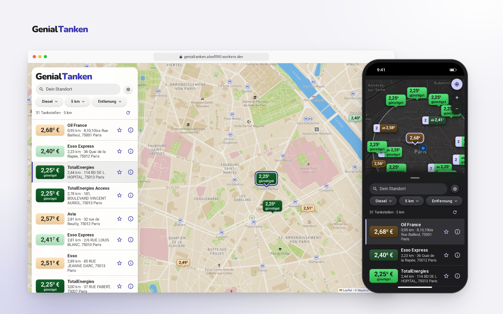
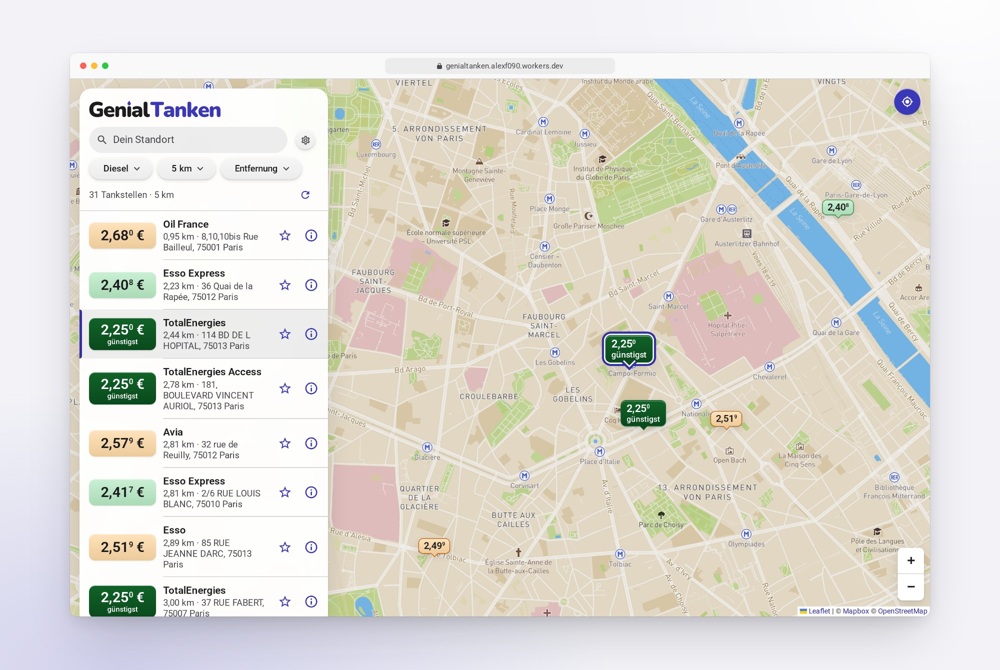
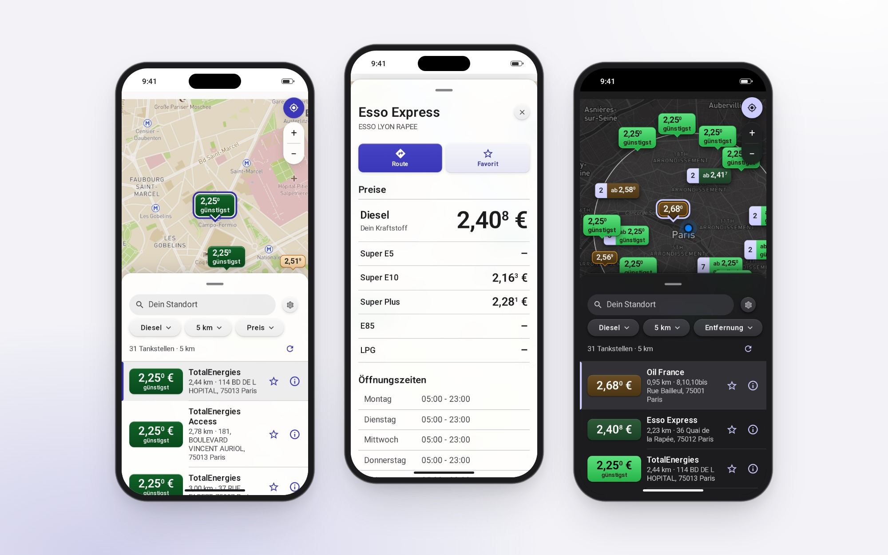
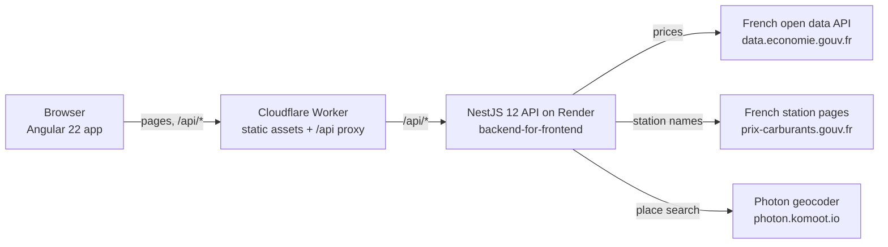

# GenialTanken

[](https://github.com/AlexF090/GenialTanken/actions/workflows/ci.yml?query=branch%3Amain)
[](https://github.com/AlexF090/GenialTanken/releases/latest)
[](https://genialtanken.alexf090.workers.dev)



Live: https://genialtanken.alexf090.workers.dev

Find the cheapest fuel nearby: current prices of the gas stations around you as a list or on a map, filtered by fuel type and radius (up to 30 km).

- **Map first, like Apple Maps:** a full-screen map with price tags under a draggable sheet (a floating side panel on larger screens) that holds the place search, filter chips for fuel, radius and sort order, your favorites and the station list. A station opens as a card with route, favorite and share actions; settings open as a dialog over the map.
- **Installable and offline-ready:** a service worker keeps the app itself, never the prices, so the installed app opens offline, says so and reloads the prices once you are back online; a notice offers a reload when a new version is out.
- **Accessible:** built for WCAG 2.2 AAA, with 7:1 text contrast, a two-tone focus ring, 44 px touch targets, Dynamic Type on iOS and opaque surfaces when you ask for reduced transparency or more contrast.
- **Quick to start:** the API sleeps on its free tier; the app wakes it on start, and a cron trigger keeps it awake during the day.

GenialTanken started as a React capstone project and is being rebuilt with Angular and NestJS. See [ROADMAP.md](ROADMAP.md) for decisions and next steps.

## Screenshots





The images show the live app with real prices. To regenerate them, run `node e2e/product-shots/capture-product-shots.ts` (details in the script header).

## Architecture



| Path                 | Content                                                                 |
| -------------------- | ----------------------------------------------------------------------- |
| `apps/web`           | Angular single-page app (standalone, zoneless, signals)                 |
| `apps/web/worker`    | Cloudflare Worker serving the app and proxying `/api` to the API        |
| `apps/api`           | NestJS backend-for-frontend (BFF)                                       |
| `packages/contracts` | zod schemas and types shared by web and API (`@genialtanken/contracts`) |
| `e2e`                | Playwright browser tests against web, API and a mocked upstream         |
| `scripts`            | Repository scripts: app icon generation, wrangler configuration check   |

The browser only talks to the BFF. The BFF queries all enabled **fuel price providers** in parallel, merges their stations into one format, sorts them by exact distance and caches the upstream responses in a size-limited in-memory cache (least recently used entries are evicted):

| Provider | Source                                                                                                                                      | Key needed         |
| -------- | ------------------------------------------------------------------------------------------------------------------------------------------- | ------------------ |
| France   | French government open data ([prix-carburants.gouv.fr](https://www.prix-carburants.gouv.fr/rubrique/opendata/)) via `data.economie.gouv.fr` | no, always enabled |

France is currently the only country. The provider architecture stays multi-country: station identifiers carry a country prefix (`fr-…`), so another country can be added as a new provider.

Favorites are loaded in one request (`GET /api/stations/by-identifiers?identifiers=…`, up to 50 identifiers); it answers with the found stations plus the unknown and the failed identifiers.

Place suggestions for the search field (`GET /api/places`) come from the public [Photon](https://photon.komoot.io/) geocoder (OpenStreetMap data), limited to France and cached for a day.

Only current prices are served; there is no price history. French data is published under the Licence Ouverte / Open Licence 2.0 (Etalab); the app credits the source.

## Tech stack

- **Web:** Angular 22, signals and `httpResource`, Signal Forms, Leaflet + markercluster, SCSS with design tokens, Vitest
- **API:** NestJS 12 (ESM), native Standard Schema validation with zod 4, environment validated by a zod schema at startup, cache-manager with an LRU store (`@cacheable/memory`), throttler, Swagger, Terminus, Vitest + Supertest
- **Shared:** TypeScript 6 strict, zod 4 contracts
- **Tooling:** pnpm 12 workspaces, ESLint (typescript-eslint strict, angular-eslint including template accessibility), Prettier, lefthook Git hooks, Playwright, dev container
- **Delivery:** GitHub Actions, Cloudflare Workers with static assets (web), Render free web service from Docker (API), Dependabot

## Running locally

The French data source needs no API key, so the app works out of the box.

### Option A: VS Code dev container (recommended)

1. Start Docker (Docker Desktop or OrbStack).
2. Open the repository in VS Code and choose **Reopen in Container**. The first build installs Node 26, pnpm and all dependencies.
3. In the VS Code terminal run `pnpm dev:container` (plain `pnpm dev` binds to `localhost` inside the container and is not reachable through the published port).
4. Open http://localhost:4200.

The container optionally mounts personal tooling from the host: the Claude Code configuration (`~/.claude`, `~/.claude.json` as a one-time seed), dotfiles (`~/Developer/dotfiles`, `~/.agents`) and the shell history (`~/.zsh_history`). It works without them: `.devcontainer/check-claude-config.sh` creates empty placeholders on the host when they are missing. The GitHub CLI keeps its login in a Docker volume (`genialtanken-gh-config`), so `gh auth login` is needed only once. Mounts change only when the container is rebuilt (**Dev Containers: Rebuild Container**).

### Option B: dev container from the command line

```bash
devcontainer up --workspace-folder .
devcontainer exec --workspace-folder . pnpm dev:container
```

`dev:container` binds the Angular dev server to all interfaces inside the container; the ports 4200 and 3000 are published to your machine. Open http://localhost:4200.

### Option C: without a container

Requires Node 26 or newer (`.nvmrc`) and pnpm 12.8.1 (pinned via `devEngines` in `package.json`):

```bash
pnpm install
pnpm dev
```

### Git hooks

`pnpm install` installs [lefthook](https://lefthook.dev/) hooks (`lefthook.yml`): before a commit, Prettier and ESLint check the staged files; before a push, `pnpm typecheck` and `pnpm test` run. Skip them once with `LEFTHOOK=0 git commit …`.

In the dev container the hooks are installed for the Linux binary. Committing from the macOS host on the same checkout may then fail; run `pnpm install` on the host as well, or use `LEFTHOOK=0`.

### Local URLs

| URL                            | Purpose                             |
| ------------------------------ | ----------------------------------- |
| http://localhost:4200          | Web app (proxies `/api` to the API) |
| http://localhost:3000/api/docs | OpenAPI (Swagger)                   |
| http://localhost:3000/health   | Health check                        |

Every visit starts centered on the Eiffel Tower in Paris. The app asks for your location only when you press the locate button ("Meinen Standort verwenden"); outside France, search for a French place instead.

## Scripts

| Command                         | What it does                                                                        |
| ------------------------------- | ----------------------------------------------------------------------------------- |
| `pnpm dev`                      | Start web and API in watch mode                                                     |
| `pnpm build`                    | Build contracts, API and web                                                        |
| `pnpm test`                     | Unit tests of all packages and of `scripts/`                                        |
| `pnpm --filter api test:e2e`    | API end-to-end tests (Supertest, fake upstreams)                                    |
| `pnpm --filter web test:worker` | Unit tests of the Cloudflare Worker (Vitest)                                        |
| `pnpm test:e2e`                 | Browser end-to-end tests (Playwright)                                               |
| `pnpm preview:web`              | Build web, serve it with the Worker via `wrangler dev` (needs `apps/web/.dev.vars`) |
| `pnpm deploy:web`               | Build web and `wrangler deploy` it (manual; CI normally deploys)                    |
| `pnpm lint`                     | ESLint for the whole repository                                                     |
| `pnpm typecheck`                | TypeScript checks of all packages and of `scripts/`                                 |
| `pnpm format:check`             | Prettier check (`format:write` to fix)                                              |
| `pnpm generate:app-icons`       | Render the SVG sources in `apps/web/icon-source` into the PNG icons and favicon     |

## Configuration

### API (`apps/api`)

| Variable                                               | Default                               | Purpose                                                                                                                                       |
| ------------------------------------------------------ | ------------------------------------- | --------------------------------------------------------------------------------------------------------------------------------------------- |
| `PORT`                                                 | `3000`                                | HTTP port                                                                                                                                     |
| `WEB_ORIGIN`                                           | `http://localhost:4200`               | Comma-separated CORS origins                                                                                                                  |
| `FRANCE_FUEL_PRICES_BASE_URL`                          | `https://data.economie.gouv.fr`       | French open data API                                                                                                                          |
| `FRANCE_STATION_DETAILS_BASE_URL`                      | `https://www.prix-carburants.gouv.fr` | Website of the French price service; station names and brands come from its station pages                                                     |
| `FRANCE_STATION_DETAILS_CACHE_TIME_TO_LIVE_IN_SECONDS` | `604800`                              | How long French station names stay cached (default one week)                                                                                  |
| `FRANCE_STATION_DETAILS_TIME_BUDGET_IN_MILLISECONDS`   | `3000`                                | Total time one station search waits for French station pages; stations whose page has not arrived by then are served without name             |
| `PHOTON_BASE_URL`                                      | `https://photon.komoot.io`            | Photon (komoot) geocoder behind the place search (`GET /api/places`)                                                                          |
| `PLACES_CACHE_TIME_TO_LIVE_IN_SECONDS`                 | `86400`                               | Cache lifetime of place search answers                                                                                                        |
| `UPSTREAM_TIMEOUT_IN_MILLISECONDS`                     | `8000`                                | Timeout per upstream request                                                                                                                  |
| `CACHE_TIME_TO_LIVE_IN_SECONDS`                        | `300`                                 | Cache lifetime of upstream responses                                                                                                          |
| `CACHE_MAXIMUM_ENTRIES`                                | `5000`                                | Maximum number of in-memory cache entries; the least recently used are evicted beyond it                                                      |
| `FRANCE_SEARCHED_RECORDS_MAXIMUM_ENTRIES`              | `2000`                                | Records kept from recent French searches for detail and favorites lookups, apart from the cache; the oldest are evicted beyond it             |
| `RATE_LIMIT_REQUESTS_PER_MINUTE`                       | `60`                                  | Requests per client, route and minute                                                                                                         |
| `PROXY_SHARED_SECRET`                                  | _(unset)_                             | Shared with the Cloudflare Worker (same name there, at least 32 characters); only then is the forwarded client address used for rate limiting |

Invalid values stop the API at startup with a clear message. The API does not read `.env` files; export variables or use `node --env-file`.

### Web (`apps/web`)

| Variable                     | Purpose                                                                                      |
| ---------------------------- | -------------------------------------------------------------------------------------------- |
| `NG_APP_MAPBOX_ACCESS_TOKEN` | Public Mapbox token (`pk.*`) read at build time; without it the map uses OpenStreetMap tiles |

CI passes the repository variable `MAPBOX_ACCESS_TOKEN` only to builds of `main`: the token is restricted to the production URL and Mapbox allows no wildcards, so pull request previews use OpenStreetMap tiles.

### Cloudflare Worker (`apps/web/worker`, set in Cloudflare)

| Variable              | Kind     | Purpose                                                                                 |
| --------------------- | -------- | --------------------------------------------------------------------------------------- |
| `API_ORIGIN`          | variable | `https://` origin of the API on Render; plain `http://` only for localhost              |
| `PROXY_SHARED_SECRET` | secret   | Same value as in the API; lets the Worker pass the client address for per-client limits |

Locally `pnpm preview:web` reads both from `apps/web/.dev.vars` (git-ignored).

## Testing

- **Unit (Vitest):** contracts schemas, API mappers and parsers, Angular services and components through their public interfaces.
- **API end-to-end (Supertest):** the real Nest application against fake upstream servers for the French open data, the French station pages and Photon.
- **Browser end-to-end (Playwright):** web + API + a local stand-in for the French open data API and the Photon place search serving recorded real data, on their own ports (web 4300, API 3100, mock upstream 4110), so a running dev server is never reused. Every request leaving the app fails the run unless it is mocked; a global teardown checks the mock upstream for unexpected requests. A desktop project covers all pages (including axe WCAG 2.2 AAA checks in light and dark mode, with more contrast and with reduced transparency); a phone project (Pixel 7) covers the bottom sheet and repeats the axe checks in the phone viewport. A `pwa` project runs against a production build with the service worker (`e2e/pwa-server.ts`, port 4400) and checks the offline start.

## Deployment

All services run on free tiers:

- **Web:** Cloudflare Worker `genialtanken` with static assets, deployed by GitHub Actions after CI passed: production on `main` (https://genialtanken.alexf090.workers.dev), a preview version per pull request that is ready for review (`https://pr-<number>-genialtanken.alexf090.workers.dev`). CI skips draft pull requests, so open them as drafts and mark them ready when final. The Worker serves the single-page app and forwards `/api/*` to the API (`run_worker_first`).
- **API:** Render free web service built from `apps/api/Dockerfile` ([render.yaml](render.yaml)); deploys after the GitHub checks of the commit passed. The free tier sleeps after 15 minutes without traffic and then needs about a minute to start. A cron trigger of the Worker calls `/health` every 10 minutes from 06:00 to midnight Berlin time (about 560 of the 750 free instance hours a month), and the web app calls `/api/wake-up` on start; a request during a cold start shows a hint.

Runbook for settings, secrets, deploys and releases: [docs/deployment.md](docs/deployment.md).

## Versions

Releases are automatic: after CI passed on `main`, [semantic-release](https://semantic-release.gitbook.io/) derives the next version from the squash commit, which carries the pull request title (`fix` → patch, `feat` → minor, `!` → major). It bumps every `package.json`, writes `CHANGELOG.md`, tags `v<version>` and publishes the release notes on [GitHub Releases](https://github.com/AlexF090/GenialTanken/releases). Pull request titles must therefore follow [Conventional Commits](https://www.conventionalcommits.org/); a check enforces it.

- **1.0.0** – original React capstone (tag `v1.0.0`)
- **2.0.0** – Angular + NestJS rebuild (tag `v2.0.0`)

## License

Copyright (c) 2026 Alex F. All rights reserved. The source is published for reference; see [LICENSE](LICENSE). Contribution guidelines: [CONTRIBUTING.md](CONTRIBUTING.md). Security issues: [SECURITY.md](SECURITY.md).
